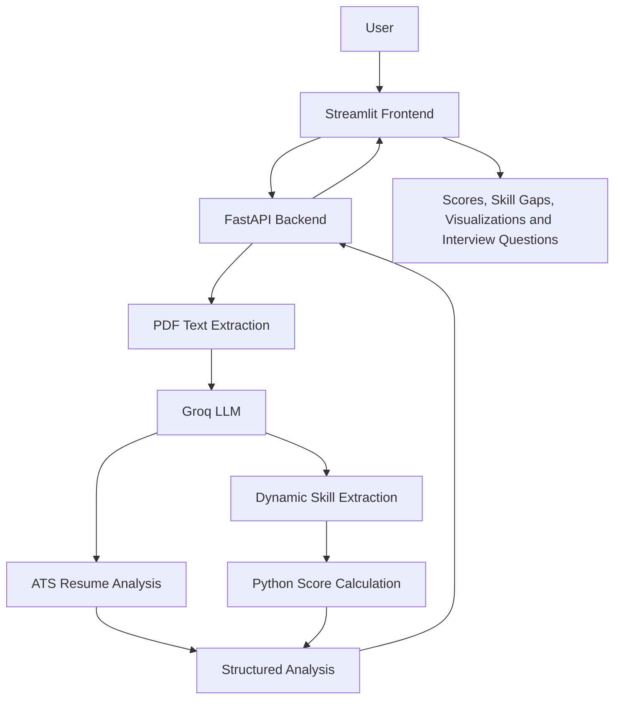

# 🤖 AI Resume Screening System

An LLM-powered resume screening application that analyzes candidate resumes against job descriptions, identifies skill gaps, evaluates resume quality, and generates interview questions.

<p align="center">
  <a href="https://ai-resume-screening-system-oqdvq9a8fd5qzcads8s8.streamlit.app/">🚀 Live Application</a> •
  <a href="https://ai-resume-screening-system-r5oo.onrender.com/docs">📚 API Documentation</a> •
  <a href="https://github.com/gunjankumar96740/ai-resume-screening-system">💻 Source Code</a>
</p>

---

## 📌 Project Overview

Recruiters often spend considerable time manually reviewing resumes against job descriptions.

This project automates the initial resume screening process using Large Language Models (LLMs).

Users upload a PDF resume and provide a job description. The application analyzes both documents and generates structured insights to help evaluate candidate-job alignment.

## ✨ Key Features

- **Resume Parsing:** Extracts text from PDF resumes using PyPDF2.
- **Dynamic Skill Extraction:** Uses Groq LLM to identify relevant skills without relying on a fixed skill dictionary.
- **Skill Gap Analysis:** Identifies matched and missing skills based on job requirements.
- **ATS Scoring:** Evaluates resume quality and job-relevant content.
- **Job Match Scoring:** Calculates a match percentage from matched and missing skills.
- **Candidate Insights:** Generates strengths and weaknesses.
- **Interview Preparation:** Generates easy, medium, and hard interview questions.
- **Interactive Visualizations:** Displays score comparisons and skill distribution.
- **REST API:** Provides resume analysis through FastAPI.
- **Docker Support:** Containerizes the backend application.

## 🌐 Live Application

| Component | Link |
|---|---|
| Streamlit Application | [Open Application](https://ai-resume-screening-system-oqdvq9a8fd5qzcads8s8.streamlit.app/) |
| FastAPI Backend | [Open API](https://ai-resume-screening-system-r5oo.onrender.com/) |
| Swagger Documentation | [Explore API](https://ai-resume-screening-system-r5oo.onrender.com/docs) |
| GitHub Repository | [View Source Code](https://github.com/gunjankumar96740/ai-resume-screening-system) |

## 🏗️ System Architecture



## 🛠️ Technology Stack

| Technology | Purpose |
|---|---|
| Python | Core programming language |
| Streamlit | Interactive frontend |
| FastAPI | Backend REST API |
| Groq API | LLM-powered resume analysis |
| GPT-OSS-20B | Language model used for analysis |
| PyPDF2 | PDF text extraction |
| Pydantic | Structured response validation |
| Pandas | Visualization data processing |
| Docker | Backend containerization |
| Render | Backend deployment |
| Streamlit Community Cloud | Frontend deployment |
| Git & GitHub | Version control |

## 📂 Project Structure

```text
resume-screening-ai/
│
├── app/
│   ├── __init__.py
│   ├── frontend.py
│   ├── llm.py
│   ├── main.py
│   ├── parser.py
│   ├── prompts.py
│   └── schemas.py
│
├── uploads/
├── venv/
│
├── .env
├── .gitignore
├── Dockerfile
├── requirements.txt
└── readme.md
```

*Note: `.env`, `venv/` and uploaded resume files should remain excluded from Git.*

## ⚙️ Local Installation

### 1. Clone the repository

```bash
git clone https://github.com/gunjankumar96740/ai-resume-screening-system.git

cd ai-resume-screening-system
```

### 2. Create a virtual environment

```bash
python -m venv venv
```

Activate on Windows PowerShell:

```powershell
.\venv\Scripts\Activate.ps1
```

### 3. Install dependencies

```bash
pip install -r requirements.txt
```

### 4. Configure environment variables

Create a `.env` file in the project root:

```env
GROQ_API_KEY=your_groq_api_key
```

Get your API key from [Groq Console](https://console.groq.com/keys).

### 5. Start the FastAPI backend

```bash
uvicorn app.main:app --reload
```

Backend:

```text
http://127.0.0.1:8000
```

Swagger documentation:

```text
http://127.0.0.1:8000/docs
```

### 6. Start the Streamlit frontend

Open another terminal:

```bash
streamlit run app/frontend.py
```

## 🐳 Docker Deployment

### Build the Docker image

```bash
docker build -t resume-screening-ai .
```

### Run the container

```bash
docker run --env-file .env -p 8000:8000 resume-screening-ai
```

The API will be available at:

```text
http://localhost:8000
```

## 🔌 API Endpoints

| Method | Endpoint | Description |
|---|---|---|
| GET | `/` | API welcome message |
| GET | `/health` | Health check |
| POST | `/analyze-resume` | Analyze resume against job description |
| POST | `/upload-resume` | Resume upload endpoint |

Interactive API testing is available through [Swagger UI](https://ai-resume-screening-system-r5oo.onrender.com/docs).

## 📊 Analysis Output

The application provides:

- Candidate name
- ATS score
- Job match score
- Matched skills
- Missing skills
- Candidate strengths
- Candidate weaknesses
- Easy interview questions
- Medium interview questions
- Hard interview questions

## 🔮 Future Improvements

- Downloadable PDF analysis reports.
- More comprehensive resume parsing.
- Improved evidence-based skill matching.
- Automated evaluation of LLM output quality.
- Improved ATS scoring methodology.
- Support for additional document formats.
- Authentication and user management.
- Automated testing and monitoring.

## ⚠️ Limitations

- Currently supports PDF resume uploads.
- Skill extraction depends on LLM output quality.
- Scores are estimates and should not be treated as definitive hiring decisions.
- The application is a screening aid, not a replacement for human recruitment judgment.
- Uploaded resumes may contain personal information; users should handle them responsibly.

## 👨‍💻 Author

**Gunjan Kumar**

B.Tech Student | Generative AI & Machine Learning Enthusiast

GitHub: [@gunjankumar96740](https://github.com/gunjankumar96740)

---

⭐ If you find this project useful, consider giving the repository a star!

**Built with Python, FastAPI, Streamlit, Docker and LLMs.**
